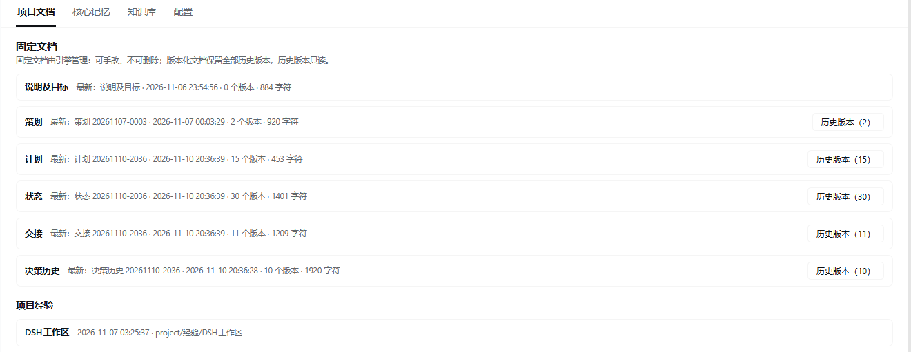

# memory-book（DSH 本地记忆插件）

给 AI 编码会话用的**按项目独立**的长期记忆：全局库 + 主项目库 + 临时项目库，全部是磁盘上的 Markdown，不上云、没有后台定时任务。

> 适配 DSH（DeepSeek Harness）0.2.1-rc.3 的插件机制；需要 Node.js ≥ 22。

## 为什么需要它

AI 编码会话最大的问题不是“记不住”，而是“记住的东西混在一起”：

- 上一个项目踩的坑，被带进另一个项目；
- 项目状态、计划、交接写在聊天里，一压缩就丢；
- 多个智能体同时改同一份记忆，互相覆盖。

memory-book 的做法：

| 能力 | 说明 |
|---|---|
| **按项目隔离** | 项目 = DSH 左侧工作区文件夹，记忆存在 `<工作区>\.memory-book\` |
| **三层注入** | 全局 + 主项目（始终注入）+ 临时项目（cd 到别的项目时追加） |
| **固定文档** | 说明及目标、策划、计划、状态、交接、决策历史、项目经验，由引擎管理版本与格式 |
| **引擎强制维护** | 检测到实质变化后自动追加一轮补更，不让文档腐烂 |
| **并发安全** | 先读再写 + mtime 乐观锁 + `based_on` 比较并交换 + 原子写 |
| **多智能体分工** | 固定文档只有 Lead 能写；队友/子代理写经验与普通页 |

## 界面截图

项目文档页：7 类固定文档、版本数与历史版本入口（固定文档可手改、不可删除）



配置页：10 项注入预算与维护节奏（含自动补更开关）


## 三层记忆

| 库 | 位置 | 何时注入 |
|---|---|---|
| 全局库 | `%USERPROFILE%\.dsh\memory\` | 任何会话都注入 |
| 主项目库 | `<会话所属工作区文件夹>\.memory-book\` | 任何会话都注入 |
| 临时项目库 | `<当前工作目录所属项目>\.memory-book\` | 仅当 `cd` 到另一个项目时追加 |

- 主项目在会话创建时确定，不随 `cd` 变化；临时项目每轮按当前工作目录现算。
- 工作目录落在任何项目之外时保持主项目；没有工作区的会话只注入全局。

## 项目库结构

```text
<项目文件夹>\
  .memory-book\
    .gitignore                      # 内容 `*`：默认整个记忆库不进 git
    core\核心记忆.md                # 每轮全文注入
    wiki\{projects,concepts,lessons,profile,entities}\*.md
    raw\*.md                        # 只登记来源定位符
    project\
      说明及目标.md                 # 单文件，正文 ≤2000 字
      经验\<类型>.md                # 同类型一个页面，全量覆盖
      策划\<YYYYMMDD-HHmm>.md       # 每次 record 新增版本，旧版保留
      计划\<...>.md
      状态\<...>.md
      交接\<...>.md
      决策历史\<...>.md
```

固定文档不会出现在普通索引里；历史版本用 `memory action=history` 列出，再 `read` 查看。

## 安装

插件以 DSH bundle（插件包）形式安装到当前 profile：

```text
plugin_manager install_bundle  target=<本仓库目录的绝对路径>
```

本地开发时 profile 里是 `link:` 链接，改完代码需要卸载再安装才会重新加载 Host 半边：

```text
plugin_manager remove_bundle  target=@local/dsh-memory-book
plugin_manager install_bundle target=<本仓库目录的绝对路径>
```

> 包名目前是 `@local/dsh-memory-book`（本地开发用的占位名）。要发布到 npm 或市场，请把 `package.json` 的 `name` 改成你自己的作用域，并同步 `cordis.patch.yml`。

## memory 工具

| action | 必填 | 说明 |
|---|---|---|
| read | path | 读整页，返回 frontmatter、正文、updated、所属库 |
| add | path, content | 新建普通页，不覆盖；content 含 frontmatter（title+summary） |
| patch | path, old_string, new_string | 片段替换，唯一匹配；固定页只能改最新版 |
| remove | path | 删除普通页；固定页拒绝 |
| search | query | 主题词检索，多词要求同时命中 |
| put | path, content | 全量覆盖固定页：`project/说明及目标` 或 `project/经验/<类型>` |
| record | doc, content, based_on | 给版本化文档新增一版；`based_on`=上一版本路径（首版传空串） |
| history | doc | 列出某版本化文档的全部版本（新→旧） |

- `scope`：`current`（默认，当前项目）/ `main`（主项目，不受 cd 影响）/ `global`（全局库）。
- **先读再写**：`patch` / `put` / `record` 前必须在本会话 `read` 过目标页，读取后文件被改过会被拒绝。
- `record` 必须带 `based_on`，不是最新版本会被拒绝（避免并发覆盖）。

## 注入与预算

面板「配置」可调 10 项：

| 项 | 默认 | 说明 |
|---|---|---|
| coreChars / mainCoreChars / transientCoreChars | 1200 / 3000 / 800 | 三层的 core 上限 |
| indexChars / mainIndexChars / transientIndexChars | 1000 / 2500 / 1200 | 三层的索引上限 |
| pagesPerDir | 8 | 每个 wiki 子目录最多列几页 |
| fallbackRounds | 5 | 连续多少用户回合无实质变化后让 AI 询问 |
| handoverChanges | 5 | 累计多少次实质变化强制更新交接 |
| autoFollowup | 开 | 引擎自动追加补更轮 |

配置落在 `%USERPROFILE%\.dsh\memory\settings.json`；删除该文件即恢复默认。

## 引擎强制维护

回合结束（`agent/status` 进入 idle）时检测，命中任意一条就追加一轮补更：

- 工作区有文件改动 / 写类工具成功 → 状态（用户表达了决策 → 决策历史）
- `todo_write` 或目标变化 → 计划 + 状态
- 工具连续失败 ≥2 次 → 项目经验
- 固定文档缺失 → 补建
- 累计 5 次实质变化 → 交接
- 本轮更新了计划/策划/交接但没更新状态 → 状态
- 连续 5 个用户回合无实质变化 → 只让 AI 询问用户，不自动写

防死循环：每用户回合最多 1 次；补更轮自身不重复触发；取消/报错/子代理不触发；`agent.followup` 不可用时降级为注入提醒。

## 多智能体协作

- 固定文档只有 Lead 能写；Agent Teams 队友、子代理写经验页与普通页。
- 并发写同一页：先读再写 + mtime 乐观锁 + `based_on` 比较并交换 + 原子写。
- 版本页 frontmatter 记录 `by` / `session`，便于排查是谁写的。

## 测试

四套离线测试，自带临时库（覆盖 `USERPROFILE` / `DSH_HOME` 与临时项目目录），不会碰真实记忆：

```powershell
node test/test-host.mjs .
node test/test-routes.mjs .
node test/test-client.mjs .
node test/test-render.mjs .
```

或一次跑完：

```powershell
npm test
```

共 279 项断言（host 124 / routes 84 / client 35 / render 36）。

## 从 0.12（单一全局库）升级

0.13 起项目记忆放在各工作区的 `.memory-book`。升级步骤：

1. 备份 `%USERPROFILE%\.dsh\memory`；
2. 安装 0.13；
3. 把原 `wiki/projects/`、`raw/` 里属于某个项目的页面移动到 `<项目>\.memory-book\` 下对应目录；
4. 每个项目补 `project/说明及目标`（≤2000 字），其余固定文档由引擎在首次会话检测缺失后强制创建。

## 设计取舍

- 三层最小化：会话证据层/待沉淀队列试过，价值低于复杂度，已移除。
- 没有定时器；补更由回合事件触发。
- 项目库默认不进 git（`.gitignore` 内容 `*`），想提交就删掉它。
- 固定文档禁止删除、历史版本只读，保证长期可追溯。

## 已知限制 / 路线图

- 面板在本地浏览器里做过渲染与接口测试；不同 DSH 版本的视觉细节可能变化。
- 项目判定依赖 DSH 的 workspace（工作区）与 working directory（工作目录）服务，DSH 接口变动需要跟进。
- 后续可做：记忆体检（孤儿页/超长页/失效引用）、跨项目引用索引、更多模板。

## 开发

- 改代码用 UTF-8；注释与文档以中文为主。
- 新增/修改行为时同步更新测试与 `CHANGELOG.md`。
- 维护者请先读 `HANDOFF.md`（升级 SOP、已知坑、版本历史）。

## 许可

[MIT](LICENSE)。欢迎 issue / PR；也可以直接 fork 后改成自己的记忆规范。
